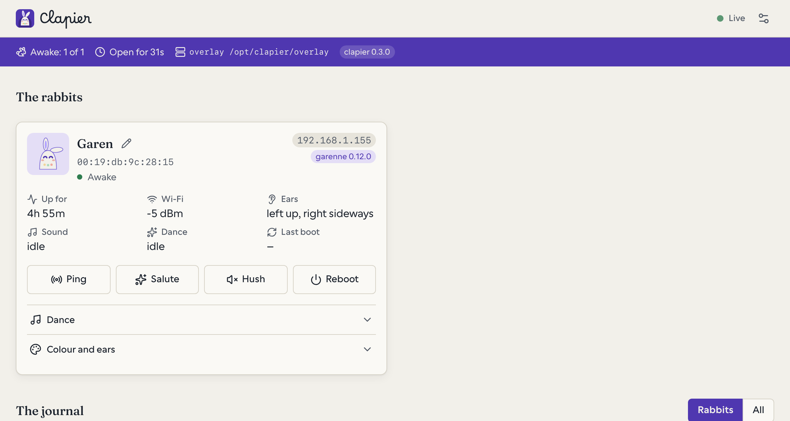

#  Clapier

[](https://github.com/synthe-se/clapier/actions/workflows/ci.yml)
[](https://github.com/synthe-se/clapier/releases)
[](CHANGELOG.md)
[](LICENSE)

The rabbits' home: one binary serves a Nabaztag:tag its brain, its
sounds and its dances, and gives you a web app to watch and drive the
whole burrow. Pairs with the [uplg/nabgcc](https://github.com/uplg/nabgcc)
`wpa23-gtk` firmware, which teaches the 2006 rabbit WPA2/WPA3.

<picture>
  <source media="(prefers-color-scheme: dark)" srcset="docs/screenshot-dark.png">
  
</picture>

## Install

Grab the [latest release](https://github.com/synthe-se/clapier/releases): Linux
(x86_64, aarch64, ARMv6 for the Raspberry Pi 1), macOS and Windows
archives carry the server, `garenne.bin` (the rabbit's brain), the
firmware flasher, the rabbit remote and the choreography encoder.
Nothing else to install.

1. **Flash once.** Head button + power: the rabbit opens a `NabaztagXX`
   access point. Join it, run `./flash-nabaztag Nab-wpa23-gtk-*.sim`.
   The bootloader is never touched: a bad flash is always recoverable.
2. **Serve.** `./clapier --bind 0.0.0.0:80 --overlay overlay` on any
   always-on box (port 80 on Linux: root, or
   `sudo setcap 'cap_net_bind_service=+ep' ./clapier`).
3. **Point the rabbit.** Config mode again, browse to
   `http://192.168.0.1`: pick your network, WPA2, your key, and your
   server's IP under "Advanced configuration". On its first boot fetch
   clapier adopts it: `garenne.bin` lands in `overlay/rabbits/<mac>/`.
4. **Open `http://<server>/`.** Name your rabbit, make it dance.

The rabbit refetches its bytecode at every boot: a bad `bc.jsp` costs a
power cycle, never a brick.

## From source

```console
$ cd web && bun install && bun run build && cd ..   # the web app, embedded at build time
$ cargo build --release
$ ./target/release/clapier --bind 0.0.0.0:8080 --overlay garenne/overlay
```

Or `just serve`. On a Raspberry Pi 1 (Alpine/OpenRC):
`PI_HOST=root@<pi> just pi` cross-builds and installs the service,
which then answers at `http://clapier.local/` (mDNS through avahi).
`./garenne/build.sh test` runs the rabbit's golden suite,
`./garenne/build.sh` builds its brain. Speech (`--say-script`,
`just say "Bonjour."`) wants [pocket-tts](vendor/pocket-tts) built once.

`just check` runs what CI runs: fmt, clippy and tests for the server,
svelte-check, the i18n and CSS checks and the tests for the web app;
`just deny` and `just vet` guard the supply chain; `just release X.Y.Z`
cuts a release.

## Architecture

```
crates/clapier         the server: CLI, router, JSON API, fleet listener
crates/clapier-vl      the file service in the rabbit's 2006 HTTP dialect
crates/clapier-pages   the embedded web app, directory listings
crates/clapier-fleet   the fleet register, learned from the wire
crates/clapier-*       journal, choreography encoder, firmware flasher
web/                   the web app: Svelte 5, Bits UI, Paraglide (fr, en)
i18n/                  its messages
garenne/               the rabbit's application (Metal bytecode, own IP stack)
docs/violet/           the original Violet and Metal documentation
```

## Standing on friendly shoulders

[Sylvain Huet](https://www.sylvain-huet.com) and the Violet team made the
rabbit and released its [sources](https://code.google.com/archive/p/nabaztag-source-code/source/default/source)
(preserved on [the Violet shelf](docs/violet/README.md));
[RedoXyde's nabgcc](https://github.com/RedoXyde/nabgcc) kept the firmware
alive; [ServerlessNabaztag](https://github.com/andreax79/ServerlessNabaztag)
showed the way.

## License

MIT. Fonts: Cal Sans and Borel (OFL 1.1, in `web/src/fonts`), Fraunces
(OFL 1.1).
